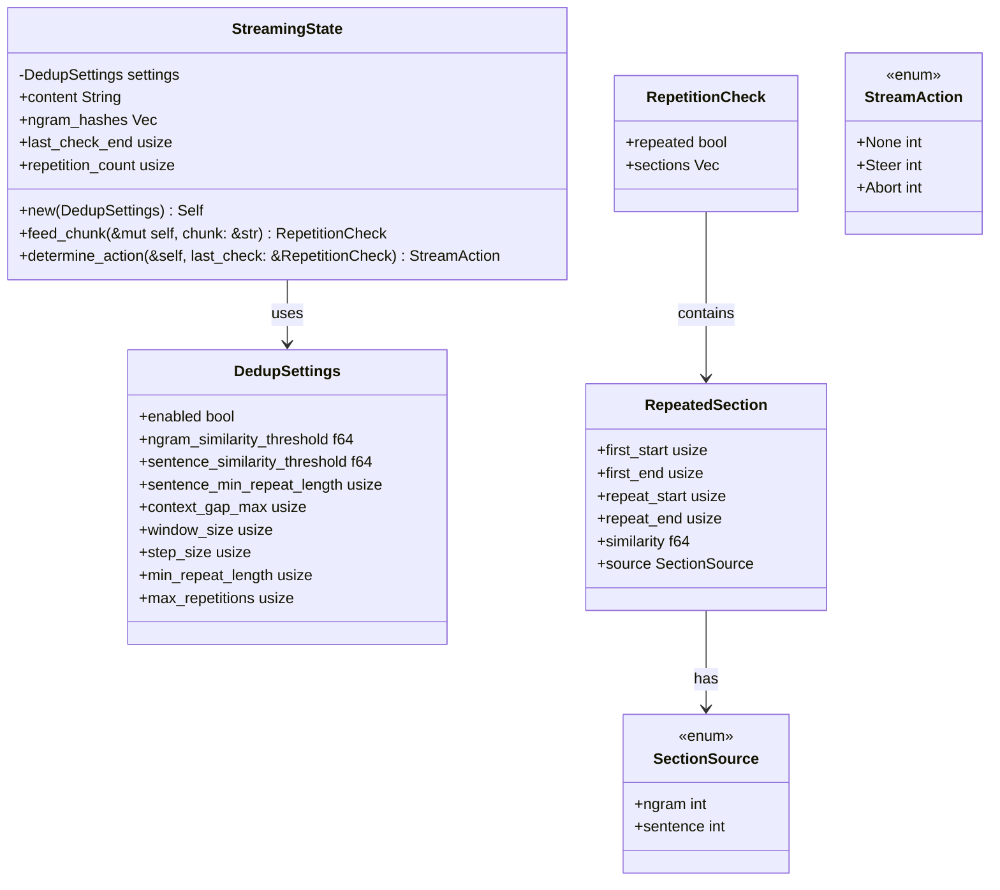
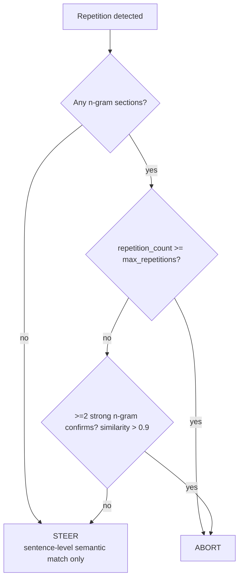
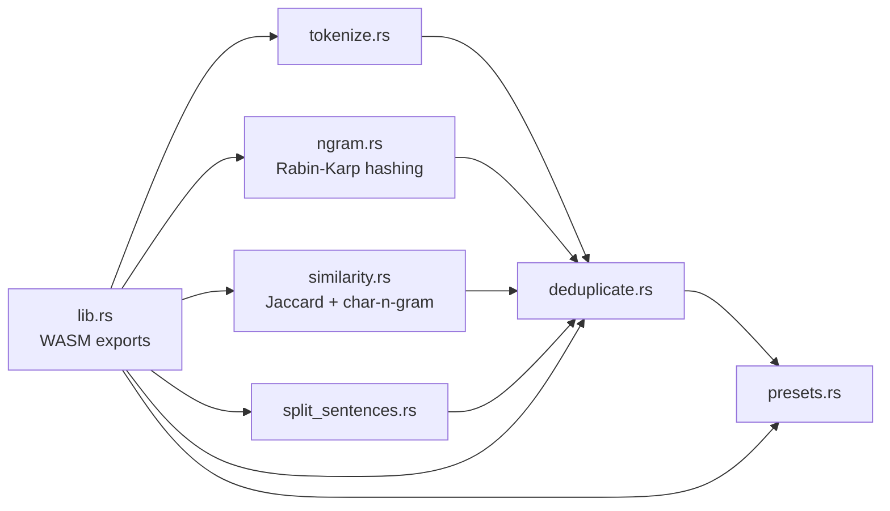
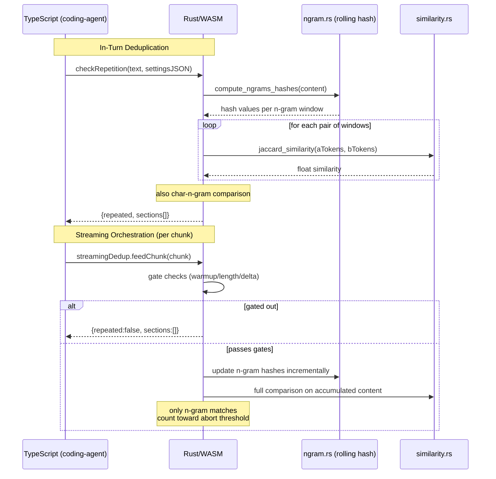

# dedup Architecture

Text deduplication for streaming assistant output, implemented in Rust and compiled to WebAssembly. The goal is to replace O(n²) n-gram comparison in TypeScript with a constant-time Rust implementation that runs on the main thread without blocking.

## Problem

The streaming deduplication system in `packages/coding-agent/src/core/` caused hangs on laptop-class machines:

- **O(n²)** n-gram comparison in `checkRepetition()`
- Repeated tokenization and Jaccard computation every check interval (500ms via `setInterval`)
- String-heavy operations blocking the main thread during generation
- No incremental computation — full re-analysis each time

## Three-Layer Defense Architecture

### Layer 1: In-Turn Text Deduplication (`deduplicate.rs`)

Detects when the model repeats itself within a single message. This handles the "the same paragraph twice" problem — identical or near-identical text appearing multiple times in one response.

**Algorithm (two-pass):**
1. **N-gram pass**: Sliding window over text, compute n-grams at configurable step size, hash each with Rabin-Karp rolling hash (`ngram.rs`). Compare pairs within the same pass using Jaccard similarity on tokenized output + character-level similarity for catches that word-level comparison misses (e.g., reworded but structurally identical sentences).
2. **Sentence pass**: Split text into sentences, compute Jaccard over tokenized sentence pairs with proximity gating (gap > `contextGapMax` chars → contextual variation, not a loop). Requires corroborating evidence: ≥2 similar pairs OR one very strong pair (>0.9 similarity) confirmed by n-gram pass.

**Why two passes:** The n-gram pass is strict (threshold 0.95 default) and catches near-exact duplicates fast. The sentence pass is looser (threshold 0.75) but requires corroboration so legitimate rephrasing like "r docs" vs "documentation" never triggers a false-positive abort.

### Layer 2: Streaming Orchestration (`deduplicate.rs` — `StreamingState`)

Incremental state machine for real-time detection during generation. Replaces the old TS timer-polling approach with Rust-native gating that runs inside each chunk's processing pipeline.

**Gating behavior:**

| Gate | Condition | Effect |
|------|-----------|--------|
| Warmup (non-WASM) | First 3 seconds of content accumulation | Suppresses all checks |
| Content length | Total accumulated text < `min_repeat_length * 8` (~400 chars) | Returns empty check without analysis |
| Chunk delta | No new characters arrived since last check | Prevents rapid-fire re-checking on tiny chunks |

**Action determination logic:**

## Module Dependency Graph

## WASM Export Surface

All public functions are exported via `wasm-bindgen` and callable from TypeScript:

| Rust Function | WASM Export | JS Signature |
|---------------|-------------|--------------|
| `check_repetition(text, settings)` | `dedup_check_repetition` | `(text, settingsJson) => {repeated, sections[]}` |
| `deduplicate_text(text, settings)` | `dedup_deduplicate_text` | `(text, settingsJson) => string` |
| `get_repetition_ratio(text, settings)` | `dedup_get_repetition_ratio` | `(text, settingsJson) => number` |
| `jaccard_similarity(tokens_a, tokens_b)` | `dedup_jaccard_similarity` | `(tokensA, tokensB) => number` |
| `tokenize(text)` | `dedup_tokenize` | `(text) => string[]` |
| `resolve_dedup_preset(name)` | `dedup_resolve_preset` | `(name) => DedupSettings JSON` |

## Cross-Module Data Flow

## Preset Resolution

Three presets with specific parameter overrides — defaults are applied first, then the preset's override map is merged in:

| Preset | N-Gram Threshold | Sentence Threshold | Window Size | Step Size | Min Repeat Length | Max Repetitions |
|--------|------------------|-------------------|-------------|-----------|-------------------|-----------------|
| default | 0.95 | 0.75 | 100 | 25 | 50 | 3 |
| relaxed | 0.92 | 0.75 | 100 | 15 | 80 | 3 |
| sensitive | 0.95 | 0.75 | 100 | 3 | 30 | 3 |

When only `similarityThreshold` is set (legacy API), both n-gram and sentence thresholds are populated from it, matching the TS semantics.

## WASM Binary Size

| Metric | Value |
|--------|-------|
| Raw `.wasm` size | ~1.5 MB |
| Gzipped size | ~402 KB |
| Target (original) | < 250 KB gzipped |

The binary is larger than the original target because it includes all three layers plus serde serialization/deserialization for JSON interop with TypeScript. Optimization candidates: strip debug symbols, enable `lto = "thin"`, or remove unused features from serde/wasm-bindgen dependencies.

## Hard-Won Lessons (from Phase 0–5)

1. **`std::time::Instant` is not available on wasm32-unknown-unknown**. The warmup gate in Rust uses it — must be gated behind `#[cfg(not(target_arch = "wasm32"))]`. This was the root cause of a panic when WASM tried to create the streaming state.

2. **`getrandom` requires the `wasm_js` feature** for random hashing in ahash/RandomState on wasm32. Added as a target-specific dependency: `{ git = "https://git.sly.so/kade/getrandom", features = ["wasm_js"] }`. This creates a version conflict with kade's fork of wasm-bindgen — resolved by pointing both to the same git commit.

3. **`HashSet` iteration order is not deterministic**. Tokenize returns different JSON array orders on repeated calls for identical input. Always sort token arrays before asserting equality in tests.

4. **Only n-gram (near-exact) sections count toward abort threshold**. Sentence-level semantic matches steer but never accumulate to abort — this prevents the classic "r docs" vs "documentation" false positive from killing streams.

5. **WASM FFI uses pointer/length + malloc/free**, not direct value passing. String marshaling between JS and WASM memory is handled by `__wbindgen_malloc`, `__wbindgen_realloc`, `__wbindgen_free` (the glue code generated by wasm-bindgen).

6. **Externref table initialization** requires a specific setup in the loader — 4-slot grow with `(undefined, null, true, false)` pattern so error values can be thrown across FFI boundaries via `takeFromExternrefTable(idx)`.

7. **WASM imports must match exact names from the binary**. The import `__wbg___wbindgen_throw_9c75d47bf9e7731e` needs a triple-underscore prefix (`__wbg_`) — matching exactly what wasm-bindgen generates in `_bg.wasm`. Using `__wbindgen_throw_*` without the `__wbg_` prefix fails with "function import requires a callable" because WebAssembly resolves imports by exact string match.

8. **WASM `getRandomValues` import** is needed for ahash's RandomState on wasm32 (random number seeding). Provide it via: `(bufPtr, bufLen) => { crypto.getRandomValues(memory.subarray(bufPtr >>> 0, bufLen)); }`. Must be called with the buffer range as two separate i32 parameters.

9. **`__wbindgen_cast_0000000000000001` cast intrinsic** for `Ref(String) → Externref`: takes a pointer + length pair, decodes from UTF-8, returns the JS string as an externref table slot.

10. **WASM module initialization requires calling `__wbindgen_start()`** after creating the Instance to finalize externref table setup. Without this call, error throwing across FFI boundaries may not work correctly.
