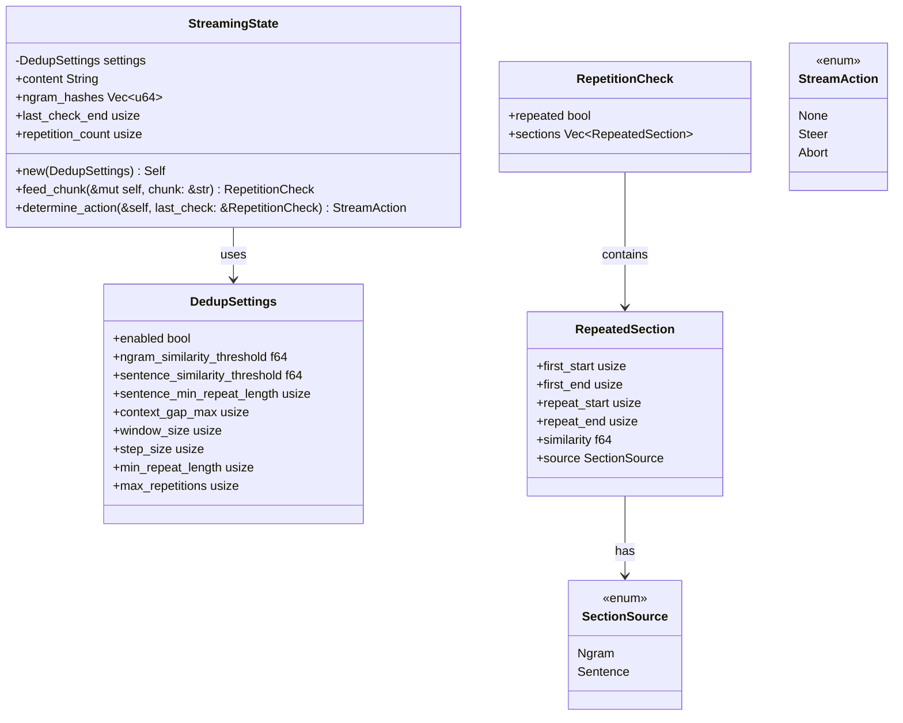
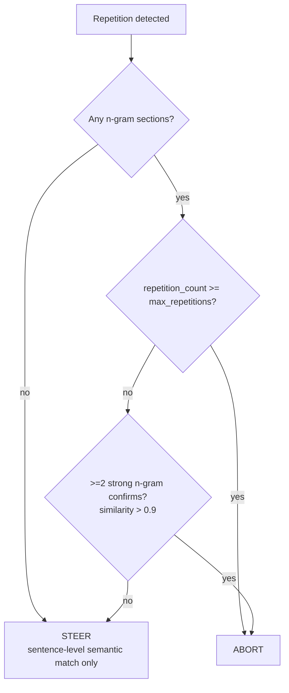
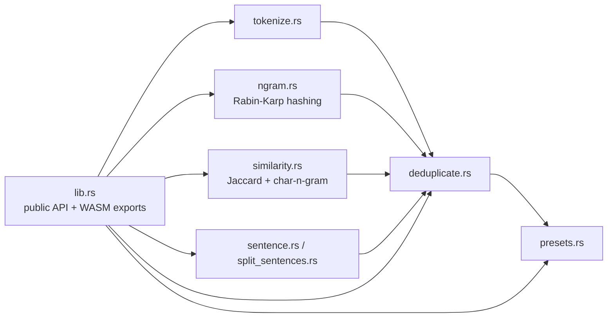
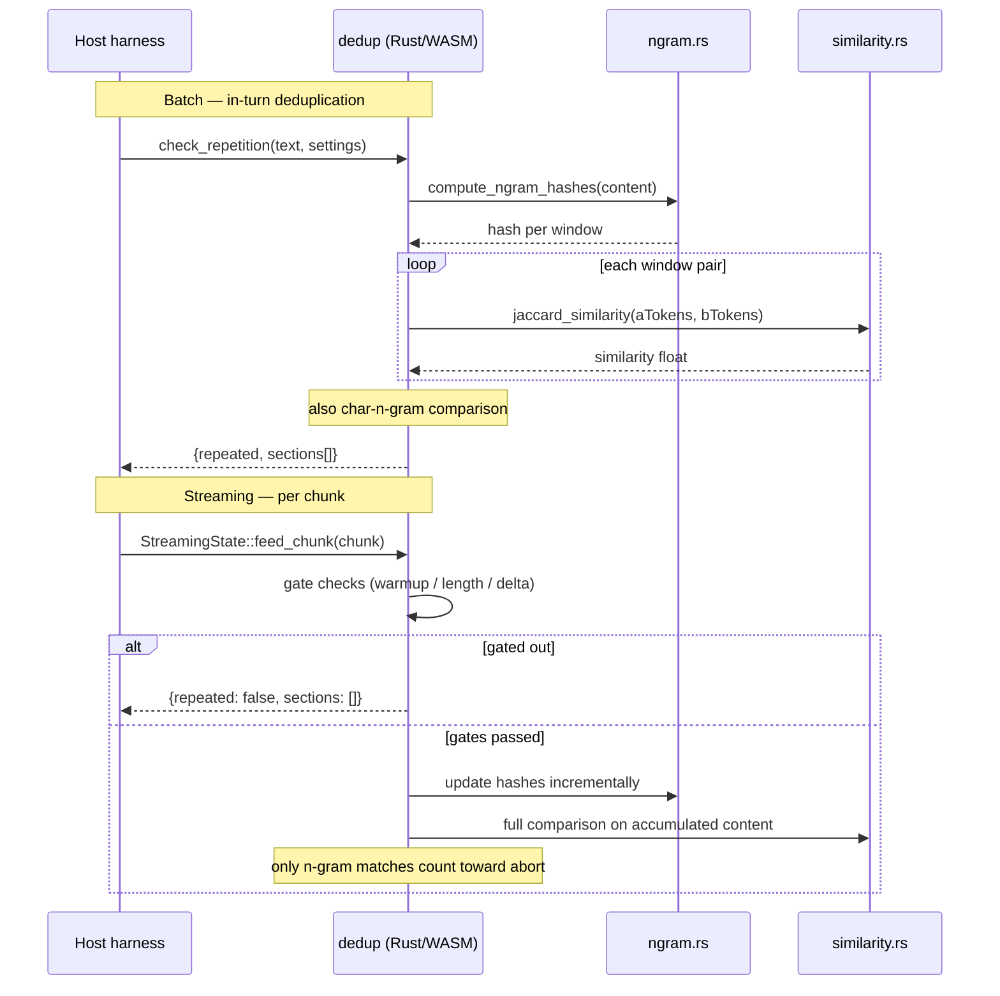

# dedup Architecture

`dedup` is a text repetition detection engine for streaming LLM output, implemented in Rust with a WebAssembly target for JavaScript hosts. It ships three cooperating layers: near-exact duplicate detection (n-gram), semantic repetition detection (sentence-level), and a streaming state machine that turns detections into an action policy (`none` / `steer` / `abort`) during generation.

## Design Goals

- **Incremental over polling.** The streaming monitor consumes chunks as they arrive via `feed_chunk()`. There are no timers on the host side; gating logic lives inside the monitor.
- **Cheap steady state.** Warmup, content-length, and chunk-delta gates mean normal, non-repetitive output pays almost nothing per chunk.
- **No false-positive aborts.** Only near-exact (n-gram) repetition accumulates toward abort. Sentence-level semantic similarity can steer but never terminates a stream — reworded-but-different content ("r docs" vs "documentation") is never fatal.
- **Host-agnostic core.** The algorithms are pure Rust with no I/O; the WASM boundary is a thin export surface over the same code paths tested natively.

## Three-Layer Detection

### Layer 1: In-Turn Text Deduplication (`deduplicate.rs`)

Detects when a model repeats itself within a single message — identical or near-identical text appearing multiple times in one response.

**Two-pass algorithm:**

1. **N-gram pass**: sliding window over the text, n-grams computed at configurable step size and hashed with Rabin-Karp rolling hash (`ngram.rs`). Window pairs are compared within the pass using Jaccard similarity on tokenized output (`similarity.rs`), plus character-level similarity as a fallback that catches word-level misses (reworded but structurally identical sentences).
2. **Sentence pass**: text split into sentences (`split_sentences.rs`, `sentence.rs`); Jaccard similarity over tokenized sentence pairs with proximity gating — gaps larger than `context_gap_max` indicate contextual variation rather than a loop. The sentence pass requires corroboration: at least two similar pairs, or one very strong pair (> 0.9 similarity) confirmed by the n-gram pass.

**Why two passes:** the n-gram pass is strict (default threshold 0.95) and catches near-exact duplicates fast. The sentence pass is looser (0.75) but requires corroboration, so legitimate rephrasing never triggers an abort.

### Layer 2: Streaming Orchestration (`StreamingState`)

An incremental state machine for real-time detection during generation. Each output chunk passes through `feed_chunk()`, which applies gates internally before running analysis.

**Gating behavior:**

| Gate | Condition | Effect |
|------|-----------|--------|
| Warmup (native builds only) | First ~3 seconds of content accumulation | Suppresses all checks |
| Content length | Total accumulated text < `min_repeat_length * 8` (~400 chars default) | Returns empty check without analysis |
| Chunk delta | No new characters since last check | Prevents rapid-fire re-checking on tiny chunks |

### Layer 3: Action Determination

After each check, `determine_action()` classifies the stream state:

- **None** — keep streaming normally
- **Steer** — inject a corrective signal; used for sentence-level matches so soft signals cannot kill a stream
- **Abort** — terminate; reserved for confirmed near-exact loops

## Module Dependency Graph

## Public API Surface

Native callers use the functions directly; WASM exports mirror them via wasm-bindgen.

| Function | Purpose |
|----------|---------|
| `check_repetition(text, settings)` | Two-pass check → `{repeated, sections}` |
| `deduplicate_text(text, settings)` | Remove repeated sections from text |
| `get_repetition_ratio(text, settings)` | Ratio of repetitive content, 0.0–1.0 |
| `jaccard_similarity(tokens_a, tokens_b)` | Token-set similarity |
| `tokenize(text)` | Shared tokenizer |
| `resolve_dedup_preset(name)` | Named preset → `DedupSettings` |
| `StreamingState::new / feed_chunk / determine_action` | Incremental streaming monitor |

## Cross-Module Data Flow

## Preset Resolution

Presets apply defaults first, then merge a named override map:

| Preset | N-Gram Threshold | Sentence Threshold | Window Size | Step Size | Min Repeat Length | Max Repetitions |
|--------|------------------|-------------------|-------------|-----------|-------------------|-----------------|
| default | 0.95 | 0.75 | 100 | 25 | 50 | 3 |
| relaxed | 0.92 | 0.75 | 100 | 15 | 80 | 3 |
| sensitive | 0.75 | 0.75 | 100 | 3 | 30 | 3 |

For compatibility, setting only a single `similarity_threshold` populates both n-gram and sentence thresholds from it.

## Binary Size

| Metric | Value |
|--------|-------|
| Raw `.wasm` size | ~1.5 MB |
| Gzipped size | ~402 KB |

The binary includes all three layers plus serde serialization for JSON interop. Optimization candidates: strip debug symbols, remove unused serde/wasm-bindgen features. Release profiles already use `opt-level = "z"`, `lto = true`, `panic = "abort"`, `codegen-units = 1`.

## WASM Portability Notes

Practical constraints discovered while building the wasm32 target — relevant to anyone embedding or rebuilding the module:

1. **`std::time::Instant` is unavailable on `wasm32-unknown-unknown`.** The warmup gate uses it, so it is gated behind `#[cfg(not(target_arch = "wasm32"))]`.
2. **`getrandom` requires the `wasm_js` feature** for random hash seeding (ahash `RandomState`) on wasm32. It is declared as a target-specific dependency. Both serde forks and wasm-bindgen must point at compatible revisions to avoid version conflicts in the workspace lockfile.
3. **String marshaling uses pointer/length pairs plus malloc/free**, handled by `__wbindgen_malloc`, `__wbindgen_realloc`, and `__wbindgen_free` — no generated glue needed at runtime if the host implements these helpers directly (see the r bridge package for a reference implementation).
4. **Externref table initialization** requires a 4-slot grow with `(undefined, null, true, false)` so error values can cross the FFI boundary via `takeFromExternrefTable(idx)`.
5. **Import names must match exactly.** `__wbg___wbindgen_throw_*` needs the `__wbg_` prefix; WebAssembly resolves imports by exact string match.
6. **`getRandomValues` import** feeds ahash seeding: `(bufPtr, bufLen) => crypto.getRandomValues(memory.subarray(bufPtr >>> 0, bufLen))`, called with two separate i32 parameters.
7. **`__wbindgen_start()` must be called after instantiation** to finalize externref table setup; error throwing across the boundary misbehaves otherwise.

Testing note: `HashSet` iteration order is not deterministic across calls — sort token arrays before asserting equality in tests.

## Integration

The canonical consumer integration lives in the [r](https://git.sly.so/kade/r) monorepo: `packages/dedup-wasm` (JS bridge package) and `packages/coding-agent/src/core/{deduplication,stream-deduplication,loop-detection}.ts` (harness wiring). See [INTEGRATION.md](./INTEGRATION.md) for the full guide, including porting steps for other harnesses such as Codex and Claude Code.
