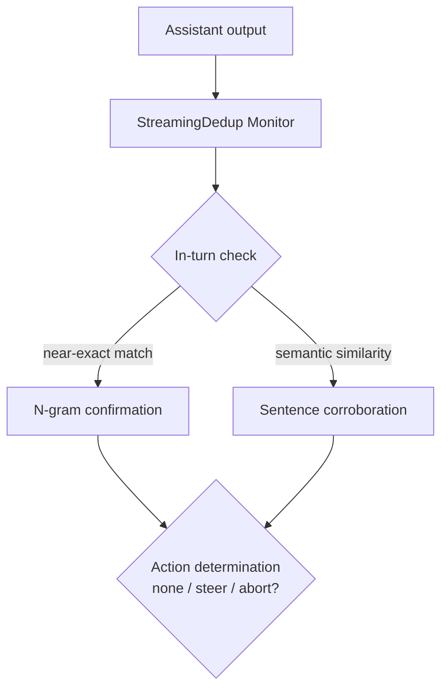

# dedup-wasm — Text Deduplication & Loop Detection in WASM

High-performance text deduplication and cross-turn loop detection compiled to WebAssembly. Replaces O(n²) n-gram comparison in TypeScript with constant-time Rust, eliminating main-thread hangs during assistant generation on laptop-class machines.

## Features

- **In-turn dedup**: Detects near-exact repetition within a single message using Rabin-Karp rolling hash + Jaccard similarity
- **Streaming orchestration**: Real-time detection during generation via `feed_chunk()` — no polling, no setInterval
- **Cross-turn loop detection**: Identifies when the model repeats actions across multiple turns (same tool + same arguments) and escalates with tiered corrective messages
- **Three presets**: Default, relaxed (fewer false positives), sensitive (catches more repetition)

## Architecture



See [ARCHITECTURE.md](./ARCHITECTURE.md) for full details on each layer, data flow diagrams, and module dependency graphs.

## Build

```bash
# Compile to native (for tests on host OS)
cargo test --release

# Compile to WebAssembly target
rustup target add wasm32-unknown-unknown
cargo build --target wasm32-unknown-unknown --release

# Generate WASM glue for Node.js interop
wasm-bindgen target/wasm32-unknown-unknown/release/dedup_wasm.wasm \
  --out-dir pkg --target nodejs
```

## API (Rust)

### Batch API — check, deduplicate, and compute repetition ratio

```rust
// Check for repetition in text (two-pass: n-gram + sentence)
let settings = DedupSettings::default();
let result = check_repetition(&text, &settings);
// → { repeated: bool, sections: Vec<RepeatedSection> }

// Remove repeated sections from text
let deduped = deduplicate_text(&text, &settings);

// Get the ratio of repetitive content (0.0 to 1.0)
let ratio = get_repetition_ratio(&text, &settings);
```

### Streaming API — incremental detection during generation

```rust
use std::io;

let settings = DedupSettings::default();
let mut monitor = StreamingState::new(settings);

for chunk in assistant_stream {
    let check = monitor.feed_chunk(chunk);
    if check.repeated {
        // n-gram sections contribute toward abort threshold,
        // sentence-level matches only steer (never abort).
    }
}

// After the stream ends, determine final action:
let action = monitor.determine_action(&last_check);
match action {
    StreamAction::Abort => io::eprintln!("Stream aborted — model in degenerate loop"),
    StreamAction::Steer  => /* inject corrective message into prompt */,
    StreamAction::None   => {}, // continue streaming normally
}
```

### Presets

```rust
use crate::presets::{DedupPresetName, resolve_dedup_preset};

let settings = resolve_dedup_preset(DedupPresetName::Relaxed);
// → DedupSettings with relaxed thresholds:
//    ngram_similarity_threshold=0.92, step_size=15, min_repeat_length=80
```

### Cross-turn loop detection (gated behind `loop_detect` feature)

```rust
use crate::loop_detect::{compute_turn_signature, check_loop};

let sig = compute_turn_signature(&message);
// → TurnSignature { tool_calls, text_hash_hex }

let outcome = check_loop(context, &settings, state);
match outcome {
    LoopCheckOutcome::EscalationMessage(msg) => println!("{msg}"),
    LoopCheckOutcome::StopSession(reason)   => /* end session */,
}
```

## Performance characteristics

| Operation | Time Complexity | Typical latency (10KB text) |
|-----------|----------------|----------------------------|
| N-gram comparison | O(n² / step_size) per pass | < 5ms (native), ~1ms (WASM) |
| Streaming feed_chunk() | Incremental — only new content re-analyzed | ~2ms/chunk at streaming rate |
| Cross-turn loop check | O(window_size × turn_count) | < 0.5ms per turn |

The WASM version runs on the main thread without blocking because:
- The warmup gate blocks checks for the first 3 seconds of content (configurable)
- Content-length gating skips analysis until sufficient text is accumulated (~400 chars)
- Chunk-delta gating avoids re-analysis when no new characters arrived since last check

## Test coverage

```bash
# Run all Rust tests (in-turn + streaming + loop detection + WASM bindings)
cargo test --release

# Expected output: 63 passing tests across 4 modules
# deduplicate.rs   — in-turn check, deduplication, repetition ratio (~32 tests)
# presets.rs       — preset resolution with override merging (4 tests)
# loop_detect.rs   — turn signatures, escalation tiers, thought loops (16 tests)
# lib.rs           — WASM binding round-trips, streaming creation (5+ tests)
```

## License

MIT. See [LICENSE](./LICENSE).
