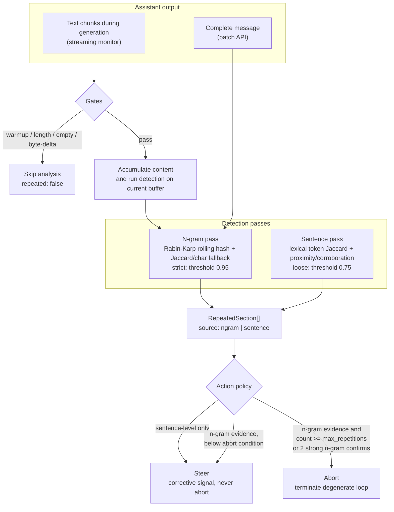

# dedup

Text repetition detection and deduplication for streaming LLM output, written in Rust with WebAssembly support.

The crate answers three questions about a piece of text:

1. **Is it repetitive?** Near-exact duplicates via n-gram/Rabin-Karp comparison, plus sentence-level lexical overlap (token Jaccard) as softer corroborating evidence.
2. **How repetitive?** A repetition ratio and byte ranges for repeated sections.
3. **What should the caller do about it?** A streaming monitor that classifies live output into `none`, `steer`, or `abort`.

It is designed to be embedded in inference harnesses and agent runtimes: batch functions for post-hoc analysis of complete messages, and a `StreamingState` monitor that consumes chunks as they arrive during generation.

## Overview

`dedup-wasm` processes text through two detection passes whose findings feed a shared action policy:



**Important distinction:** only near-exact n-gram evidence is treated as abort-worthy. Sentence-level matches are lexical overlap signals (not semantic understanding) and are used to steer, not to kill a stream.

See [ARCHITECTURE.md](./ARCHITECTURE.md) and [INTEGRATION.md](./INTEGRATION.md) for implementation and embedding details. When docs and code disagree, the implementation and tests in this repository are the source of truth.

## Features

- N-gram pass for near-exact repetition: sliding-window n-grams hashed with Rabin-Karp rolling hashes, compared with Jaccard similarity and a character-level fallback for cases word-level comparison misses.
- Sentence pass for lexical overlap: sentence segmentation with proximity gating (`context_gap_max`) and corroboration requirements to reduce false positives from incidental similarity.
- Streaming monitor: `StreamingState::feed_chunk()` accumulates chunks and performs gated checks over the current buffer (warmup, minimum content length, empty-chunk and byte-delta gates). It is designed for low overhead in normal generation, but it is not a fully incremental rolling index.
- Action policy: `none`, `steer`, `abort`. N-gram evidence drives abort decisions; sentence-only evidence is steer-only.
- Presets: `default`, `relaxed`, `sensitive` with defined threshold, length, repetition overrides.
- Dual target: native Rust library (`rlib`) and WebAssembly (`cdylib` for `wasm32-unknown-unknown`) via wasm-bindgen.

## Quick start (Rust)

```rust
use dedup_wasm::{check_repetition, DedupSettings};

let settings = DedupSettings::default();
let result = check_repetition("some assistant output ...", &settings);
if result.repeated {
    for section in &result.sections {
        println!(
            "repeat at {}..{} (similarity {:.2}, source {:?})",
            section.repeat_start, section.repeat_end, section.similarity, section.source
        );
    }
}
```

### Streaming

```rust
use dedup_wasm::{DedupSettings, StreamingState, StreamAction};

let mut monitor = StreamingState::new(DedupSettings::default());

for chunk in assistant_stream {
    let check = monitor.feed_chunk(chunk);
    if check.repeated {
        // inspect check.sections / check.source as needed
    }

    match monitor.determine_action(&check) {
        StreamAction::Abort => { /* terminate: degenerate loop */ }
        StreamAction::Steer => { /* inject corrective signal */ }
        StreamAction::None  => {}
    }
}
```

### Presets

```rust
use dedup_wasm::{resolve_dedup_preset, DedupPresetName};

let settings = resolve_dedup_preset(DedupPresetName::Relaxed);
```

| Preset | `ngram_similarity_threshold` | `sentence_similarity_threshold` | `min_repeat_length` | `max_repetitions` | Notes |
|---|---:|---:|---:|---:|---|
| `default` | 0.95 | 0.75 | 50 | 3 | Baseline settings |
| `relaxed` | 0.92 | 0.75 | 80 | 3 | Less sensitive n-gram threshold, longer minimum repeat |
| `sensitive` | 0.75 | 0.75 | 30 | 3 | More sensitive n-gram threshold, shorter minimum repeat |

Note: preset/settings fields such as `window_size` and `step_size` are part of the public settings shape, but their effective influence depends on the current implementation. Treat the code and tests as authoritative. A rewrite plan to make knob behavior and docs consistent is tracked separately.

## JavaScript / WASM usage

The crate compiles to WebAssembly and can be consumed from JavaScript hosts via wasm-bindgen bindings. A maintained bridge package lives at [`packages/dedup-wasm`](https://git.sly.so/kade/r/src/branch/main/packages/dedup-wasm) in the [r](https://git.sly.so/kade/r) monorepo:

```ts
import { initDedupWasm, createStreamingDedup, tokenize } from "@entropy-tamer/r-dedup-wasm";

await initDedupWasm();
const tokens = JSON.parse(tokenize("hello world hello"));
```

See [INTEGRATION.md](./INTEGRATION.md) for embedding guidance and the `r` integration.

## Build

```bash
# Native checks
cargo test --release
cargo fmt --all -- --check
cargo clippy --all-targets --release -- -D warnings

# WebAssembly target
rustup target add wasm32-unknown-unknown
cargo build --target wasm32-unknown-unknown --release
cargo check --target wasm32-unknown-unknown --release

# Optional: generate JS bindings for a host
wasm-bindgen target/wasm32-unknown-unknown/release/dedup_wasm.wasm \
  --out-dir pkg --target nodejs
```

Dependencies are pinned to forks on `git.sly.so` (including serde/serde_json, wasm-bindgen, ahash, regex, once_cell). The `getrandom` wasm32 build uses the `wasm_js` feature as configured in [Cargo.toml](./Cargo.toml).

## Behavior notes and caveats

- Lexical, not semantic: sentence-level similarity is token/lexical overlap (Jaccard-based), not meaning-aware semantic matching.
- Streaming checks are gated: warmup (native), minimum content length, empty-chunk and byte-delta gates reduce scan frequency. When a scan runs, detection operates on the accumulated buffer.
- Offsets are byte offsets: repeated section ranges are Rust byte offsets into UTF-8 text. Consumers must interpret them accordingly.
- WASM portability: `std::time::Instant`-based warmup behavior differs on `wasm32-unknown-unknown` (compiled out there); bridge/runtime behavior should account for this.
- Docs lag code in places: [ARCHITECTURE.md](./ARCHITECTURE.md) may not match all implementation details. A characterization-first rewrite plan (ABI-frozen, wave-based) is tracked in project todos to align behavior, knob semantics, segmentation, documentation.

## Test coverage

```bash
cargo test --release
```

Current test targets:
- `src/lib.rs` unit tests
- `test/dedup_tests.rs` integration tests (batch and streaming behavior, including regression scenarios)

## Repository layout

```text
src/
  lib.rs           Public API surface and WASM exports
  deduplicate.rs   Detection passes, streaming monitor, action policy
  ngram.rs         Rabin-Karp rolling-hash n-gram extraction/matching
  similarity.rs    Jaccard token similarity + character n-gram fallback
  sentence.rs      Sentence segmentation + sentence-pass analysis
  tokenize.rs      Tokenization shared by passes
  presets.rs       Named preset resolution
test/
  dedup_tests.rs   Integration tests
```

## License

MIT. See [LICENSE](./LICENSE).
