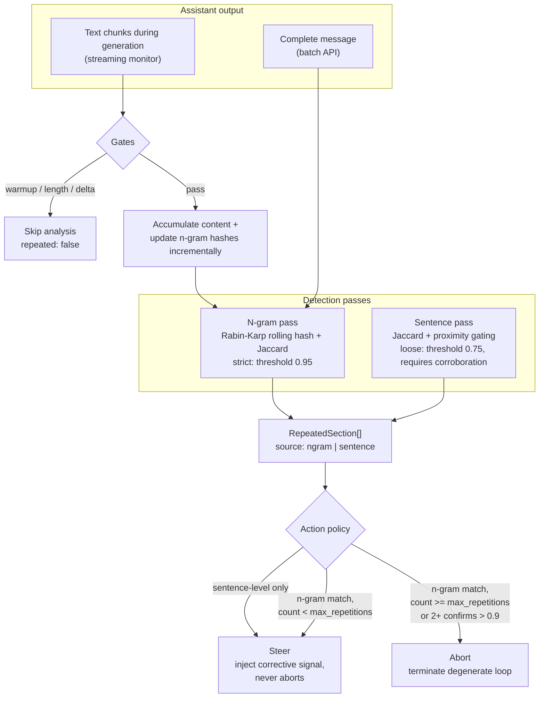

# dedup

Text repetition detection and deduplication engine for streaming LLM output, written in Rust with first-class WebAssembly support.

The crate answers three questions about a piece of text:

1. **Is it repetitive?** — near-exact duplicates via n-gram comparison, semantic repetition via sentence-level similarity
2. **How repetitive?** — a normalized repetition ratio and byte ranges of every repeated section
3. **What should the caller do about it?** — a streaming state machine that classifies live output into `none` / `steer` / `abort`

It is designed to be embedded in inference harnesses and agent runtimes: batch functions for post-hoc analysis of complete messages, and an incremental `StreamingState` monitor that consumes chunks as they arrive during generation.

## Overview

dedup processes text through two independent detection passes whose findings feed a shared action policy:



The key asymmetry: only near-exact (n-gram) repetition accumulates toward abort. Sentence-level semantic similarity can steer, but reworded-but-different content never kills a stream.

See [ARCHITECTURE.md](./ARCHITECTURE.md) for full details on each layer, data flow diagrams, and module dependency graphs.

## Features

- **N-gram pass** — sliding-window n-grams hashed with Rabin-Karp rolling hashes, compared pairwise with Jaccard similarity plus character-level fallback for catches word-level comparison misses
- **Sentence pass** — sentence segmentation with proximity gating (`context_gap_max`) so legitimate contextual variation is not flagged; requires corroborating evidence (multiple similar pairs or one very strong pair confirmed by the n-gram pass)
- **Streaming monitor** — incremental `feed_chunk()` state machine with warmup, content-length, and chunk-delta gating; no polling timers required from the host
- **Action policy** — only near-exact (n-gram) repetitions accumulate toward abort; softer sentence-level matches steer but never kill a stream
- **Presets** — `default`, `relaxed`, `sensitive` with documented parameter overrides
- **Dual target** — native (`rlib`) for Rust hosts, `cdylib`/`wasm32-unknown-unknown` for JavaScript hosts via wasm-bindgen

## Quick start (Rust)

```rust
use dedup_wasm::{check_repetition, DedupSettings};

let settings = DedupSettings::default();
let result = check_repetition("some assistant output ...", &settings);
if result.repeated {
    for section in &result.sections {
        println!("repeat at {}..{} (similarity {:.2}, source {:?})",
            section.repeat_start, section.repeat_end, section.similarity, section.source);
    }
}
```

### Streaming

```rust
use dedup_wasm::{DedupSettings, StreamingState, StreamAction};

let mut monitor = StreamingState::new(DedupSettings::default());

for chunk in assistant_stream {
    let check = monitor.feed_chunk(chunk);
    if check.repeated {
        // n-gram sections accumulate toward abort;
        // sentence-level matches steer only.
    }
}

match monitor.determine_action(&last_check) {
    StreamAction::Abort => { /* terminate: degenerate loop */ }
    StreamAction::Steer => { /* inject corrective message */ }
    StreamAction::None  => {}
}
```

### Presets

```rust
use dedup_wasm::{resolve_dedup_preset, DedupPresetName};

let settings = resolve_dedup_preset(DedupPresetName::Relaxed);
```

| Preset | N-Gram Threshold | Sentence Threshold | Window Size | Step Size | Min Repeat Length | Max Repetitions |
|--------|------------------|-------------------|-------------|-----------|-------------------|-----------------|
| default | 0.95 | 0.75 | 100 | 25 | 50 | 3 |
| relaxed | 0.92 | 0.75 | 100 | 15 | 80 | 3 |
| sensitive | 0.75 | 0.75 | 100 | 3 | 30 | 3 |

## JavaScript / WASM usage

The crate compiles to WebAssembly and is consumed from Node.js through a thin FFI bridge with no generated-glue runtime dependency. A maintained bridge package lives at [`packages/dedup-wasm`](https://git.sly.so/kade/r/src/branch/main/packages/dedup-wasm) in the [r](https://git.sly.so/kade/r) monorepo:

```ts
import { initDedupWasm, createStreamingDedup, tokenize } from "@entropy-tamer/r-dedup-wasm";

await initDedupWasm();
const tokens = JSON.parse(tokenize("hello world hello"));
```

See [INTEGRATION.md](./INTEGRATION.md) for the full embedding guide, including the r integration and porting instructions for other harnesses.

## Build

```bash
# Native build + test suite
cargo test --release

# WebAssembly target
rustup target add wasm32-unknown-unknown
cargo build --target wasm32-unknown-unknown --release

# Generate bindings for a JS host
wasm-bindgen target/wasm32-unknown-unknown/release/dedup_wasm.wasm \
  --out-dir pkg --target nodejs
```

Note: dependencies are pinned to forks on `git.sly.so` (serde, serde_json, wasm-bindgen, ahash, regex, once_cell). The `getrandom` wasm32 dependency requires the `wasm_js` feature; see [ARCHITECTURE.md](./ARCHITECTURE.md#wasm-portability-notes) for details.

## Performance characteristics

| Operation | Complexity | Typical latency (10 KB text) |
|-----------|------------|------------------------------|
| N-gram comparison | O(n² / step_size) per pass | < 5 ms native |
| Streaming `feed_chunk()` | Gated re-analysis, not algorithmically incremental | ~2 ms per chunk at streaming rate |
| N-gram worst case (long repetitive stream) | O(n² / step_size) on accumulated length | Spikes on pathological inputs — gating keeps steady-state near zero |

Gating keeps steady-state cost near zero during normal generation:

- **Warmup gate** — checks suppressed during initial content accumulation (native builds)
- **Content-length gate** — no analysis until accumulated text reaches `min_repeat_length * 8`
- **Chunk-delta gate** — skips re-analysis when a chunk adds no new characters

## Test coverage

```bash
cargo test --release
```

Two test targets cover the crate:

- `lib` unit tests — in-turn checking, deduplication, presets, WASM binding exports
- `dedup_tests` — integration tests over the batch and streaming APIs, including scenario regressions

## Repository layout

```
src/
  lib.rs           Crate root, public API surface, WASM exports
  deduplicate.rs   Two-pass detection + StreamingState monitor
  ngram.rs         Rabin-Karp rolling-hash n-gram extraction
  similarity.rs    Jaccard token similarity + character n-gram fallback
  sentence.rs      Sentence segmentation + sentence-pass analysis
  tokenize.rs      Tokenization shared by all passes
  presets.rs       Named preset resolution
test/
  dedup_tests.rs   Integration tests
```

See [ARCHITECTURE.md](./ARCHITECTURE.md) for layer diagrams, data flow, gating behavior, action policy, and WASM portability notes.

## License

MIT. See [LICENSE](./LICENSE).
